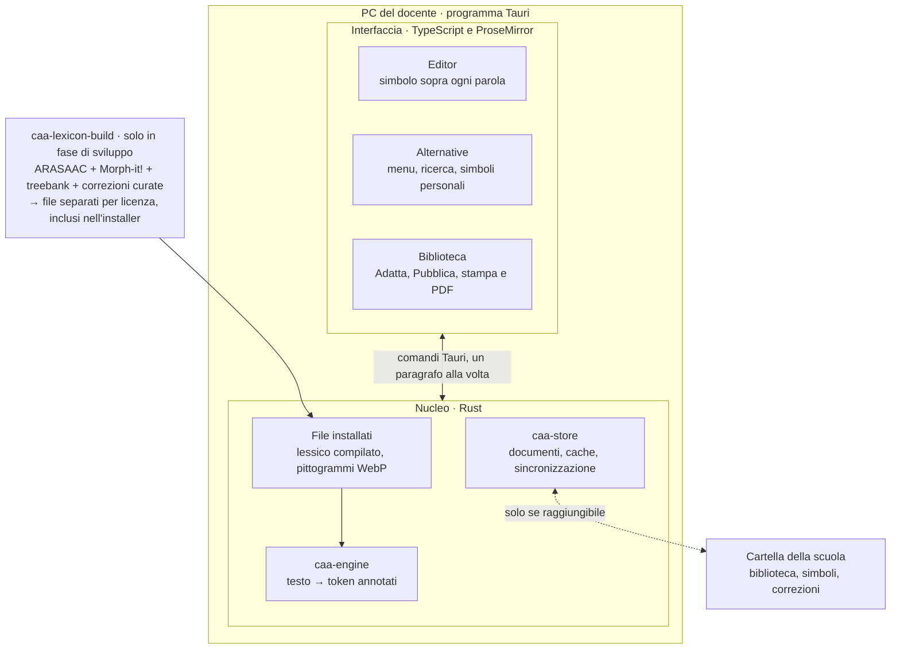
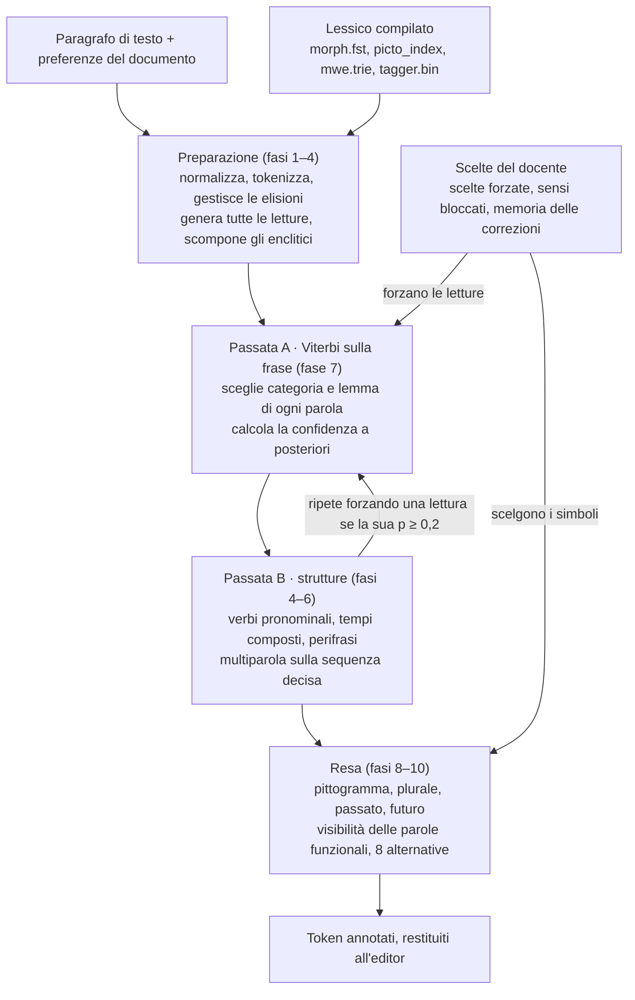

# Specifica v1 — Editor CAA in simboli

Versione del 23/11/2026

## Scopo e contesto

Costruiamo un programma gratuito, installato sui PC della scuola, con cui i docenti scrivono un testo e vedono comparire sopra ogni parola il pittogramma giusto, già flesso (plurale, passato, futuro), pronto da stampare. È l'alternativa a SymWriter per l'IIS Sraffa, senza costi di licenza.

**Per chi.** Gli utenti sono i docenti (sostegno e curricolari), non gli studenti. Il programma serve a preparare materiali: storie da leggere, testi semplificati, consegne, avvisi. Le verifiche in CAA sono rare e restano fuori dalla prima versione.

**Perché non bastano gli strumenti esistenti.**

- **SymWriter** simbolizza bene mentre si scrive, ma ha un costo di licenza per postazione e usa simboli Widgit proprietari, diversi da quelli che gli studenti usano con logopedisti e CTS.
- **SimCAA** è gratuito e usa ARASAAC, ma è macchinoso: bisogna creare progetto e capitolo prima di scrivere, scrittura e impaginazione sono due ambienti separati, e plurali e tempi verbali si sistemano a mano.

**Cosa facciamo diversamente.** Apri, scrivi, i simboli si flettono da soli, correggi con un clic, stampi. Un solo schermo. I documenti di riferimento stanno in una biblioteca condivisa sul server della scuola; ognuno ne fa una copia e la adatta ai propri studenti.

**Simboli.** Pittogrammi ARASAAC (Governo d'Aragona, licenza CC BY-NC-SA): circa 14.000 simboli (13.924 a novembre 2026), con le parole italiane già associate. Il programma è e resta **non commerciale**: nessuna vendita, nessuna pubblicità.

## Principi di progetto

Ogni scelta tecnica si misura su una domanda: un docente prepara una storia simbolizzata in meno tempo e con meno correzioni che con SymWriter o SimCAA?

1. **Zero cerimonie.** All'avvio si apre un documento vuoto pronto per scrivere. Nessun progetto, capitolo o profilo da compilare prima.
2. **Ciò che vedi è ciò che stampi.** Un solo ambiente: scrittura e impaginazione coincidono.
3. **Il motore sbaglia, il docente corregge in un clic.** Ogni parola ha le sue alternative a portata di mano. Le correzioni vengono ricordate.
4. **Il testo è la fonte di verità.** I simboli si ricalcolano dal testo; si salva solo ciò che il docente ha scelto esplicitamente.
5. **Offline per default.** Il programma funziona sempre, con o senza rete della scuola.
6. **Motore separato dall'interfaccia.** Il motore è una libreria con ingresso testo e uscita token annotati, testabile da sola.
7. **Misurare, non indovinare.** Il motore migliora solo contro un corpus di testi reali con risultati attesi.

**Criteri di successo della v1:**

| Criterio | Obiettivo |
| --- | --- |
| Parole di contenuto con simbolo corretto al primo colpo, su testi narrativi scolastici | ≥ 90% |
| Verbi con lemma e tempo corretti (incluse forme composte) | ≥ 90% |
| Tempo di simbolizzazione di un paragrafo durante la digitazione | < 30 ms |
| Avvio del programma su un PC scolastico | < 3 s |
| Correzione di un simbolo sbagliato | 1 clic + 1 scelta |

Le soglie sono obiettivi di lavoro, da ricalibrare dopo la prima misura sul corpus (vedi Valutazione).

## Perimetro della v1

La v1 fa una cosa sola molto bene: trasformare un testo italiano in testo simbolizzato stampabile, con correzioni rapide e una biblioteca condivisa.

**Dentro la v1:**

- Editor di testo con simbolo sopra ogni parola, aggiornato mentre si scrive
- Motore di simbolizzazione morfologica (sezioni Motore)
- Menu delle alternative per parola: altri pittogrammi, "nessun simbolo", parola senza simbolo, simbolo personale
- Unione e divisione manuale di gruppi di parole ("scuola media" come un simbolo solo, o due)
- Formattazione minima: titolo, paragrafo, grassetto, dimensione testo, colore del testo
- 4 dimensioni di simbolo predefinite (piccolo, medio, grande, molto grande)
- Regole per articoli e preposizioni configurabili per documento
- Simboli personali: importare un'immagine (foto o disegno) e associarla a una parola
- Biblioteca condivisa sul server della scuola, copie personali locali, "Adatta" e "Pubblica"
- Stampa A4 e esportazione PDF
- Installer Windows (MSI) per distribuzione sui PC della scuola

**Fuori dalla v1 (vedi `docs/IDEE.md`):**

- Verifiche, tabelle, campi da compilare
- Griglie di scrittura assistita per studenti, accesso con sensori
- Sintesi vocale
- Tabelle di comunicazione
- Versione web o mobile
- macOS e Linux (Tauri li supporta, ma non li testiamo in v1)
- Collaborazione in tempo reale

## Architettura

Applicazione desktop **Tauri 2**: il nucleo (motore, archivio, sincronizzazione) è in **Rust**, l'interfaccia è in **TypeScript** dentro la webview di sistema (WebView2, già presente su Windows 10/11). Si ottiene un programma installabile e offline senza dover scrivere un motore di impaginazione testuale nativo.



Il motore non tocca mai la rete né il disco: legge solo il lessico già caricato in memoria.

**Moduli (workspace Cargo + frontend):**

| Modulo | Linguaggio | Responsabilità | Dipende da |
| --- | --- | --- | --- |
| `caa-engine` | Rust (libreria pura, nessun I/O) | Testo → token annotati con lemma, categoria, tratti, pittogramma, modificatori, alternative | Lessico compilato |
| `caa-lexicon-build` | Rust (strumento a riga di comando) | Costruisce il lessico compilato da ARASAAC, Morph-it! e correzioni curate | Dati sorgente |
| `caa-eval` | Rust (riga di comando) | Esegue il motore sul corpus di test e produce le metriche | `caa-engine` |
| `caa-store` | Rust | Documenti, biblioteca, copie personali, sincronizzazione su cartella di rete | File system |
| `src-tauri` | Rust | Comandi esposti all'interfaccia, accesso ai pittogrammi locali, impostazioni | Tutti i precedenti |
| `ui` | TypeScript + Vite + ProseMirror (pannelli in Svelte) | Editor, menu alternative, biblioteca, stampa | Comandi Tauri |

**Regole architetturali:**

- `caa-engine` non conosce né l'editor né il file system: riceve una stringa e un insieme di preferenze, restituisce token. Così si testa da solo e, in futuro, si compila anche in WebAssembly per una versione web.
- L'interfaccia chiede la simbolizzazione **per paragrafo**, non per documento: a ogni modifica si rianalizza solo il paragrafo toccato.
- **Offset dei caratteri:** Rust lavora in byte UTF-8, JavaScript in unità UTF-16. Ogni token restituito porta gli offset già convertiti in UTF-16, altrimenti le parole accentate (è, perché, città) sfasano i simboli. Va coperto da test fin dal primo giorno.
- I pittogrammi sono installati in locale con il programma e serviti all'interfaccia tramite un protocollo interno (`picto://<id>`), mai scaricati a runtime.
- Il lessico compilato è un file versionato prodotto in fase di build: il programma non elabora mai i dati grezzi di ARASAAC o Morph-it!.

## Fonti dati e licenze

Tre fonti, tenute in **file separati** e unite solo a runtime tramite la stringa del lemma. Separarle non è un dettaglio: le due licenze copyleft (BY-NC-SA e BY-SA) non permettono di fonderle in un'unica opera derivata.

| Fonte | Cosa fornisce | Licenza | File compilato |
| --- | --- | --- | --- |
| ARASAAC | 13.924 pittogrammi (novembre 2026), parole chiave italiane per pittogramma, categoria della parola chiave | CC BY-NC-SA 4.0 ([Global Symbols](https://globalsymbols.com/symbolsets/arasaac/symbols/14323?locale=tr)) | `picto_index.bin` + cartella immagini |
| Morph-it! | Forme flesse → lemma + tratti morfologici | CC BY-SA 2.0 oppure LGPL, a scelta ([readme](https://app.unpkg.com/italian-verbs-dict@3.4.0/files/dist/readme-morph-it.txt)) | `morph.fst` + `morph_feats.bin` |
| Correzioni curate (nostre) | Forme mancanti, lessico scolastico, preferenze lemma→pittogramma, regole su parole funzionali | Nostra scelta (consigliata CC BY-SA, per restituire alla comunità) | `overrides/*.tsv` versionati in git |

### ARASAAC

- Ogni pittogramma ha un id numerico e, per lingua, una lista di parole chiave (124 pittogrammi non ne hanno in italiano). Ogni parola chiave porta una **categoria numerica**, verificata su esempi reali in M1 ([bildquelle](https://github.com/Lautstark/bildquelle) citava solo i tipi 2 e 3): 1 = nomi propri e luoghi, 2 = nomi comuni, 3 = verbi (anche perifrasi come "fare il bagno"), 4 = aggettivi, numeri e avverbi, 5 = frasi, esclamazioni e cartelli, 6 = orari, mesi, pulsanti e parole funzionali isolate; 615 parole chiave non hanno tipo e non sono affidabili per il punteggio. Una parola chiave può avere un campo `plural` (7.079 casi: "ape" → "api"); 52 volte coincide con la parola stessa. Dettagli e conteggi in `docs/RAPPORTO-M1.md`.
- Molte parole chiave sono **multiparola** ("ferro da stiro", "scuola media"): diventano voci del dizionario delle espressioni (fase 6 del motore).
- Le immagini si scaricano per id dal server statico; un dataset pubblico usa lo schema `static.arasaac.org/pictograms/<id>/<id>_<risoluzione>.png` ([Propicto](https://huggingface.co/datasets/Propicto/propicto-orfeo/blob/ac2b428b88a77b1aa2257cc3a5209b63883de1c5/README.md)). Verificati in M1: le parole chiave si scaricano da `https://api.arasaac.org/v1/pictograms/all/it` e le immagini sono disponibili a 300, 500 e 2500 px.
- **Risoluzione consigliata:** 500 px, convertiti in WebP alla build. Basta per la stampa a dimensione "molto grande" e tiene l'installazione su qualche centinaio di MB (misurati: 239 MB per 13.924 immagini).
- **Attribuzione obbligatoria** nel programma (schermata Informazioni) e in fondo a ogni stampa o PDF: pittogrammi di Sergio Palao, proprietà del Governo d'Aragona, ARASAAC, licenza CC BY-NC-SA.

### Morph-it!

- Lessico di forme flesse con lemma e tratti: una riga per forma, nel formato `forma → lemma → tratti`, per esempio `caschi casco NOUN-M:p` e `abominevole abominevole ADJ:pos+m+s` ([LREC, DFKI](https://www-live.dfki.de/fileadmin/user_upload/import/6263_LREC-Merge-Res-IT-TD.pdf); [Corpora-List](https://listserv.linguistlist.org/pipermail/corpora/2004-November/005439.html)).
- La versione 048 (usata in M1) ha 505.074 righe, circa 404.700 forme e 34.600 lemmi (dopo la normalizzazione delle chiavi) e 664 etichette distinte; il file è in codifica ISO-8859-15 e va convertito in UTF-8. Due righe sono separate da spazi invece che da tabulazioni: il lettore le ripara. Il sito di Unibo rifiuta ogni User-Agent diverso da quello di curl, quindi lo script di scarico usa `curl`.
- **Lacune note, dichiarate dagli autori:** vocabolario quotidiano incompleto, nomi propri, prestiti, diminutivi e molte forme verbali con clitici attaccati ([UniBo](https://cris.unibo.it/handle/11585/15321)). Il motore deve quindi analizzare i clitici da sé (fase 4) e lo strato di correzioni deve coprire il lessico scolastico mancante. La versione 048 contiene però già alcune forme con clitici attaccati (`dammi` = dare + mi, `lavarsi` = lavare + si), conservate come clitico nelle letture.
- Le congiunzioni coordinanti e subordinanti non sono distinte: per noi è irrilevante.

### Correzioni curate

File TSV leggibili e modificabili da un docente, versionati in git:

- `forms_extra.tsv`: forme mancanti (`forma, lemma, tratti`); per le parole con una chiave ARASAAC bastano le eccezioni (fase 3, punto 2)
- `lemma_picto.tsv`: pittogramma preferito per lemma e categoria, con priorità (`lemma, categoria, id, priorità, nota`)
- `mwe_extra.tsv`: espressioni multiparola aggiuntive
- `function_words.tsv`: comportamento di articoli, preposizioni, ausiliari (simbolo, nessun simbolo, simbolo ridotto)
- `blocklist.tsv`: abbinamenti da non proporre mai (pittogrammi inadatti al contesto scolastico)

## Motore di simbolizzazione: panoramica

Il motore trasforma un paragrafo in una sequenza di token, ognuno con il suo pittogramma, i suoi modificatori e una lista ordinata di alternative. Lavora in tre fasi: **analisi** (cosa può essere ogni parola), **decisione** (cosa è in questo contesto) e **resa** (quale pittogramma, con quali segni, mostrato o no).

L'idea centrale: ogni parola genera **tutte** le letture possibili, e una sola passata di punteggio sulla frase intera sceglie la combinazione migliore. Niente regole che decidono parola per parola in modo irreversibile: le regole aggiungono o tolgono punti, la decisione è globale.



Le scelte del docente entrano due volte: come vincoli nella decisione e come priorità nella scelta del simbolo.

**Le dieci fasi, in ordine:**

1. Normalizzazione del testo
2. Tokenizzazione italiana (elisioni, apostrofi, numeri)
3. Analisi morfologica: tutte le letture di ogni forma
4. Analisi dei clitici e dei verbi pronominali
5. Raggruppamento dei tempi composti e delle perifrasi verbali
6. Riconoscimento delle espressioni multiparola
7. Disambiguazione: decodifica di Viterbi sulla frase
8. Scelta del pittogramma (senso) con la catena di priorità
9. Modificatori: plurale, passato, futuro
10. Politica di visualizzazione delle parole funzionali e costruzione delle alternative

**Contratto (Rust):**

```rust
pub struct Request<'a> {
    pub text: &'a str,                 // un paragrafo
    pub prefs: &'a DocPrefs,           // politica parole funzionali, preset
    pub forced: &'a [ForcedPick],      // scelte esplicite del docente (span + pittogramma)
    pub sense_locks: &'a SenseLocks,   // lemma -> pittogramma già scelto nel documento
    pub memory: &'a UserMemory,        // correzioni passate del docente
}

pub struct Token {
    pub span_utf16: (u32, u32),        // offset nel paragrafo, in unità UTF-16
    pub surface: String,
    pub kind: TokenKind,               // Word, Number, Punct, Symbol, Unknown
    pub analysis: Option<Analysis>,    // lemma, categoria, tratti scelti
    pub group: Option<GroupRef>,       // appartenenza a tempo composto o multiparola
    pub picto: Option<PictoRef>,       // id ARASAAC o simbolo personale
    pub modifiers: Modifiers,          // PLURAL | PAST | FUTURE (bitflag)
    pub display: Display,              // Full, Reduced, TextOnly, Hidden
    pub confidence: f32,               // 0..1, guida l'evidenziazione dei dubbi
    pub alternatives: Vec<Candidate>,  // max 8, ordinate per punteggio
    pub reason: Reason,                // perché è stato scelto (debug e menu)
}
```

Il campo `reason` non è un lusso: serve al docente per capire un errore ("scelto perché dopo un articolo") e a noi per il debug del corpus.

**Bassa confidenza = sottolineatura.** I token sotto una soglia (per partire: 0,6) vengono sottolineati in modo discreto nell'editor. Il docente controlla solo quelli, non tutto il testo.

## Motore passo per passo

Ogni fase prende la rappresentazione della precedente e la arricchisce; nessuna fase cancella informazione, al massimo abbassa un punteggio. Gli esempi usano frasi tipiche di una storia scolastica.

### 1. Normalizzazione

Lavora su una copia per la ricerca; il testo originale resta intatto per la visualizzazione.

- Unicode NFC (una è composta e una è scomposta devono diventare uguali).
- Apostrofi tipografici `’` `ʼ` `′` → `'`. Virgolette tipografiche → neutre.
- **`E'` a inizio parola → `È`**: è il modo più comune in cui si scrive la È maiuscola sulle tastiere italiane. Lo stesso per `e'` isolato → `è`, e per le forme come `perche'` → `perché`, `citta'` → `città` (solo se la forma accentata esiste nel lessico).
- Chiave di ricerca in minuscolo; la maiuscola originale si conserva come segnale (vedi nomi propri).

### 2. Tokenizzazione italiana

Divide su spazi e punteggiatura, poi gestisce i casi italiani:

- **Elisione**: un token che contiene `'` seguito da lettera si divide in due: `l'albero` → `l'` + `albero`; `dell'acqua` → `dell'` + `acqua`; `c'era` → `c'` + `era`; `quest'anno` → `quest'` + `anno`. Il prefisso eliso si risolve con una piccola tabella (`l'` → il/la/lo, `un'` → una, `dell'` → di + il, `c'` → ci, `m'` → mi, `s'` → si, `t'` → ti, `v'` → vi, `d'` → di, `quest'`, `quell'`, `nessun'`, `buon'`, `sant'`, più le preposizioni articolate `all'`, `dall'`, `nell'`, `sull'`; la tabella è `ELIDED_PREFIXES` in `caa-engine`).
- **Eccezioni**: `po'` (troncamento: "un po'" è un'espressione), `mo'`, imperativi tronchi `da'`, `fa'`, `di'`, `sta'`, `va'`.
- **Apostrofo finale** (`po'`, `E'`, `perche'`): si prova prima la forma con l'apostrofo, poi la forma accentata (`perche'` → `perché`, `E'` → `è`, solo se esiste nel lessico); se nessuna esiste è una virgoletta e si stacca come punteggiatura. Il testo originale e gli offset non cambiano mai: la normalizzazione si applica a ogni token, non al testo intero.
- **Numeri**: cifre come token `Number`; "3" e "tre" hanno lo stesso trattamento. Orari ("alle 8", "8:30") e date restano token unici.
- **Trattini**: `anti-age` resta un token; il trattino di dialogo (– o — a inizio riga) è punteggiatura.
- **Offset**: ogni token porta l'intervallo originale, già convertito in UTF-16.

### 3. Analisi morfologica: tutte le letture

Per ogni token parola si cercano **tutte** le analisi nel lessico (`morph.fst` + `forms_extra.tsv`). Esempi reali di ambiguità:

| Forma | Letture possibili |
| --- | --- |
| porta | nome femminile "porta" · verbo "portare" (3ª sing. presente, 2ª sing. imperativo) |
| era | verbo "essere" (imperfetto) · nome "era" (epoca) |
| sale | nome "sale" · verbo "salire" · plurale di "sala" |
| riso | nome "riso" (cereale o risata) · participio di "ridere" |
| ancora | avverbio · nome "ancora" · verbo "ancorare" |
| la | articolo · pronome clitico · nome (nota musicale) |

**Mappatura dei tratti.** Le etichette di Morph-it! (oltre 600 combinazioni, come `VER:ind+pres+1+p`, `NOUN-F:p`, `VER:impr+pres+2+s`, `WH-CHE`; [R0mb0](https://github.com/R0mb0/Morph-it_Lexicon_Processor_Exporter), [ACL](https://aclanthology.org/2015.mtsummit-papers.12.pdf)) si convertono alla build in una struttura interna:

```rust
pub enum Cat { Noun, Propn, Verb, Aux, Modal, Adj, Adv, Art, Adp, ArtAdp, Pron, Clitic, Det, Conj, Num, Intj, Punct, Sym }
pub struct Feats { gender: Option<G>, number: Option<N>, mood: Option<Mood>, tense: Option<Tense>, person: Option<u8>,
                   degree: Option<Degree>, enclitic: Option<Enclitic>, verb_kind: VerbKind }
```

Il primo compito su questi dati è **elencare tutte le etichette distinte** presenti nel file e scrivere la tabella di conversione completa: nessuna etichetta deve finire in un ramo "altro" non gestito. Fatto in M2: le 664 etichette sono tutte mappate (`sym` raccoglie abbreviazioni, emoticon e simboli; `verb_kind` distingue i causativi e gli aspettuali CAU e ASP; `degree` il grado dell'aggettivo; `enclitic` i 41 clitici attaccati al verbo). La tabella è in `crates/caa-lexicon-build/src/labels.rs`, le scelte in `docs/RAPPORTO-M2.md`.

**Parole sconosciute** (non in lessico):

1. **Maiuscola, anche a inizio frase** → lettura `Propn` con punteggio alto ("Marco", "Crema"). Le parole che invece sono in lessico ma hanno la maiuscola a metà frase ("Rosa", "Bianca", "Serena") ricevono una lettura Propn in più, con bonus: decide la fase 7.
2. **Chiave ARASAAC esatta**: se la forma non ha letture in Morph-it! (né in `forms_extra.tsv`) ma, normalizzata, è una chiave di `picto_index.bin`, si crea una lettura dalla categoria della parola chiave ARASAAC (tipi verificati in `docs/RAPPORTO-M1.md`): tipo 1 → `Propn`, tipo 2 → `Noun`, tipo 3 → `Verb` all'infinito, tipo 4 → `Adj` (`Adv` se termina in `-mente`). I tipi 5 e 6 (frasi, lettere, orari) e le chiavi senza tipo non producono una lettura e si prosegue con i punti seguenti. Il lemma è la chiave stessa; se la chiave è un plurale indicato da ARASAAC (flag `PLURAL_FORM`), la lettura è plurale e il lemma è la parola chiave singolare (se l'indice non basta per risalirvi, `picto_index.bin` si estende con il singolare). Genere e numero si deducono dal flag di plurale e dal suffisso (-o/-i, -a/-e); dove restano dubbi il tratto resta vuoto e decide la fase 7. Confidenza intermedia, da tarare sul corpus: la parola ha un pittogramma, ma l'analisi grammaticale è dedotta. È la regola che rende inutile elencare a mano in `forms_extra.tsv` le parole con un pittogramma ma sconosciute a Morph-it! (a novembre 2026 circa 1.150 nomi comuni); `forms_extra.tsv` resta per le eccezioni e per le forme coniugate dei verbi. `caa-eval` riporta quante parole del corpus sono risolte in questo modo.
3. **Errore di battitura**: ricerca con automa di Levenshtein a distanza 1 sul lessico (il crate `fst` lo supporta nativamente). Se c'è una sola forma vicina frequente, la si propone come lettura con confidenza bassa e la parola viene sottolineata. (Implementazione di M4: senza frequenze, vale "una sola forma a distanza 1 e parola di almeno 5 lettere".)
4. **Indovino per suffisso**: `-mente` → avverbio; `-zione`, `-sione`, `-tà` → nome femminile; `-are/-ere/-ire` → infinito; `-ando/-endo` → gerundio; `-ato/-uto/-ito` → participio. Sempre confidenza bassa.
5. Altrimenti token `Unknown`: nessun simbolo, sottolineatura.

### 4. Clitici e verbi pronominali

Morph-it! non copre molte forme con clitici attaccati, quindi il motore le scompone da sé.

**Enclitici** (attaccati in fondo al verbo): si tenta di staccare da destra al massimo due clitici, nell'ordine ammesso dall'italiano:

```text
cluster := (mi|ti|ci|vi|si|gli|lo|la|li|le|ne)
         | (me|te|ce|ve|se|glie)(lo|la|li|le|ne)
```

Poi si ricostruisce l'ospite e lo si valida nel lessico come verbo all'infinito, gerundio, imperativo o participio:

| Forma | Ospite trovato | Ricostruzione | Risultato |
| --- | --- | --- | --- |
| lavarsi | lavar | + e → lavare (inf.) | lavare + si |
| dicendolo | dicendo | gerundio valido | dire + lo |
| portamelo | porta | imperativo valido | portare + me + lo |
| dammi | dam | consonante raddoppiata → da' | dare + mi |
| condurlo | condur | + re → condurre | condurre + lo |

Regole di ricostruzione: `-ar/-er/-ir` + e; `-or`, `-ur`, `-ar` + re per porre, condurre, trarre; consonante doppia dopo `da`, `fa`, `di`, `sta`, `va` (dammi, fallo, dillo, stacci, vattene). Si accetta la scomposizione solo se l'ospite è un verbo nel lessico; altrimenti la parola resta com'è ("cartella" non diventa "carte" + "lla").

**Proclitici** (prima del verbo: "mi lavo", "glielo dico", "ne voglio"): sono già token separati; la fase 7 li riconosce dal contesto.

**Verbi pronominali.** Se un verbo ha un clitico riflessivo della stessa persona (mi lavo, ti vesti, si pettina, ci siamo divertiti, lavarsi), prima di tutto si cerca nell'indice ARASAAC la parola chiave `<infinito senza -e>si`: lavarsi, vestirsi, pettinarsi, arrabbiarsi, divertirsi. Se esiste, il clitico entra nel gruppo del verbo, viene nascosto e il gruppo prende quel pittogramma. Se non esiste, il verbo prende il pittogramma del verbo semplice e il clitico segue la politica dei pronomi.

### 5. Tempi composti e perifrasi verbali

Si scorre la frase cercando schemi sulle letture possibili (non su quelle già scelte: il gruppo diventa un'ipotesi in più per la fase 7, con un bonus).

| Schema | Esempio | Testa del gruppo | Modificatore |
| --- | --- | --- | --- |
| avere/essere presente o imperfetto + [avverbi] + participio passato | ho mangiato, era già uscito | participio | PASSATO |
| avere/essere futuro + participio | avrò finito | participio | FUTURO |
| avere/essere condizionale + participio | avrei voluto | participio | PASSATO |
| essere + stato + participio (passivo) | è stato chiamato | ultimo participio | PASSATO |
| stare presente + gerundio | sto leggendo | gerundio | nessuno |
| stare imperfetto + gerundio | stava piovendo | gerundio | PASSATO |
| riflessivo + essere + participio | mi sono lavato | pronominale (fase 4) | PASSATO |
| potere/dovere/volere + [clitico] + infinito | devo studiare, posso farlo | due simboli: modale + infinito | tempo sul modale |

Gli ausiliari del gruppo sono `Hidden` per default (configurabile). "Essere" e "avere" **non** seguiti da participio restano verbi pieni con il loro simbolo ("ho fame", "è stanco").

**Ambiguità nota:** "è chiuso" può essere passato prossimo o essere + aggettivo. Regola v1: se il participio esiste anche come aggettivo nel lessico ed è seguito da un complemento di luogo o di tempo, vince il tempo composto; altrimenti vince il prior statistico. Si misura sul corpus.

**Tempi semplici:** indicativo imperfetto e passato remoto → PASSATO; futuro semplice → FUTURO; presente, imperativo, infinito, gerundio, congiuntivo presente, condizionale presente → nessun modificatore. Il congiuntivo imperfetto ("se fosse") resta senza modificatore: in CAA non ha un segno standard.

### 6. Espressioni multiparola

Un trie costruito alla build contiene tutte le parole chiave ARASAAC con più di una parola, **lemmatizzate con lo stesso motore** ("ferro da stiro" → [ferro, da, stiro]; "lavarsi i denti" → [lavarsi, il, dente]). Lemmatizzare entrambe le parti con lo stesso codice garantisce che il confronto sia coerente.

A runtime, da ogni posizione si cammina nel trie usando l'insieme dei lemmi possibili di ogni token, saltando gli ausiliari già raggruppati. Vince la corrispondenza più lunga.

- "ho fatto colazione" → [fare, colazione] → pittogramma "fare colazione" + PASSATO.
- "i ferri da stiro" → [ferro, da, stiro] → un pittogramma + PLURALE.
- "mi sono lavato i denti" → [lavarsi, il, dente] → "lavarsi i denti" + PASSATO.

La multiparola entra nella fase 7 come ipotesi con bonus, non come decisione: se il contesto la rende improbabile, perde. Il docente può sempre dividerla o crearne una nuova (unione manuale, salvata nelle correzioni).

### 7. Disambiguazione: Viterbi sulla frase

È la fase che decide. Ogni token ha un insieme di letture (categoria + lemma + tratti, più le ipotesi di gruppo); si cerca la sequenza di letture con il punteggio totale più alto, con l'algoritmo di Viterbi. Con frasi da 20 parole e 3–4 letture per parola è questione di microsecondi.

**Punteggio di una sequenza** = somma, in logaritmo, di:

1. **Prior di lettura** `log P(lettura | forma)`: quanto spesso quella forma è quella lettura. Fonte primaria: frequenze calcolate alla build da un treebank italiano annotato (Universal Dependencies; licenza da verificare, l'uso non commerciale ci favorisce). Fonte di riserva: `ambiguity_priors.tsv` curato a mano per le 300 forme ambigue più frequenti. Senza nessuna delle due: letture equiprobabili.
2. **Transizione** `log P(categoria_i | categoria_i-2, categoria_i-1)`: probabilità della categoria dato le due precedenti (trigrammi, stimati dallo stesso treebank, con smoothing). Codifica cose come "dopo un articolo viene un nome o un aggettivo, quasi mai un verbo".
3. **Vincoli locali** (regole pesate, non assolute):
    - accordo di genere e numero tra articolo/aggettivo e nome: +1,0 se concordano, −2,0 se no;
    - soggetto pronominale (io, tu, lui, lei, noi, voi, loro) seguito da verbo finito di persona coerente: +1,5;
    - "non" seguito da verbo o clitico: +1,0;
    - preposizione "a", "di", "per", "da" seguita da infinito: +0,5;
    - modale seguito da infinito: +1,5;
    - ipotesi di gruppo (fase 5) o multiparola (fase 6) completata: +1,0.
4. **Scelte forzate dal docente**: una lettura forzata vale 0, tutte le altre letture di quel token −∞. Così una correzione su una parola aiuta anche a disambiguare le vicine.

I pesi iniziali sopra sono punti di partenza; vanno tarati sul corpus (sezione Valutazione), non a sentimento.

**Esempio.** "La porta è aperta" contro "Lei la porta a scuola":

- Nella prima, "La" a inizio frase con "porta" nome femminile singolare: articolo + nome concorda, e articolo→nome ha transizione alta. Vince porta = nome.
- Nella seconda, "Lei" pronome soggetto, poi "la": articolo→verbo ha transizione bassissima, clitico→verbo alta, e "Lei" + verbo 3ª persona riceve il bonus. Vince la = clitico, porta = portare.

**Confidenza** di ogni token = probabilità a posteriori della lettura scelta (calcolata con forward-backward sulla stessa griglia). È il numero che decide la sottolineatura.

### 8. Scelta del pittogramma

Decisa la lettura, si sceglie il pittogramma con una catena di priorità. Si prende il primo livello che dà un risultato:

1. Scelta del docente su quel token (salvata nel documento)
2. **Blocco di senso nel documento**: se il docente ha già scelto "pesca = frutto" in questo documento, tutte le altre "pesca" prendono lo stesso pittogramma (un senso per testo, euristica classica e molto efficace)
3. Memoria del docente: le sue correzioni passate per quella forma o quel lemma, pesate per frequenza e recenza
4. Gruppo o multiparola riconosciuti
5. `lemma_picto.tsv` curato (pittogramma preferito per lemma e categoria)
6. Indice ARASAAC, cercando nell'ordine:
    - la **forma esatta** ("occhiali", "forbici": i plurali fissi hanno spesso una parola chiave propria);
    - il **singolare dello stesso genere** ("maestre" → "maestra", non "maestro");
    - il **lemma**;
    - il **plurale**, se il singolare non ha pittogramma (estensione di M4: ARASAAC ha "pastelli" e "sassi", non "pastello" e "sasso").

    A parità, vince il pittogramma la cui parola chiave ha la **stessa categoria** della lettura scelta, poi quello in cui la parola è la **prima parola chiave**, poi quello con **meno parole chiave** (più specifico).
7. Stessa ricerca ignorando la categoria (penalità sulla confidenza)
8. Nessun simbolo: nell'editor compare un segnaposto tratteggiato (non stampato) che invita a scegliere.

### 9. Modificatori

- **PLURALE**: nome con numero plurale, a meno che il pittogramma trovato sia già plurale (forma esatta plurale, come "occhiali") o il nome sia invariabile e il plurale non sia determinabile.
- **PASSATO / FUTURO**: dai tempi semplici o dal gruppo verbale (fase 5), applicati al pittogramma della testa.
- La grafica dei segni deve **riprodurre la convenzione ARASAAC** (stessa forma e posizione dei segni di plurale, passato e futuro che gli studenti conoscono). Il primo compito è scaricare esempi di pittogrammi con questi segni e decidere se scaricare le varianti già pronte o disegnarle come sovrapposizione. La sovrapposizione è preferibile: un segno solo per tutti i pittogrammi, nessuna immagine in più.

### 10. Parole funzionali e alternative

**Politica per documento**, con tre preset e personalizzazione per categoria:

| Categoria | Completo | Essenziale | Note |
| --- | --- | --- | --- |
| Articoli | simbolo ridotto | nascosto | Ridotto = simbolo piccolo o solo testo |
| Preposizioni semplici | simbolo | simbolo | Portano significato spaziale |
| Preposizioni articolate | simbolo della preposizione | simbolo della preposizione | "nella" mostra "in" |
| Ausiliari nei tempi composti | nascosto | nascosto | Il tempo è nel segno |
| Clitici non riflessivi | simbolo del pronome | nascosto | |
| Congiunzioni (e, ma, o) | simbolo | simbolo | |
| "che" relativo/congiunzione | testo | nascosto | |
| Punteggiatura | testo | testo | Mai simbolo |

Il terzo preset è "Personalizzato": una tabella dove il docente cambia ogni riga. Le scelte sono salvate nel documento, così una storia preparata con una politica viene stampata identica da chiunque.

**Alternative.** Per ogni token il motore restituisce fino a 8 candidati, deduplicati per pittogramma: prima le altre letture plausibili con i loro pittogrammi, poi gli altri sensi dello stesso lemma, poi le voci fisse "solo testo", "nessun simbolo", "cerca…", "simbolo personale…". Il menu mostra anche la ragione in una riga ("nome, dopo articolo").

## Motore: esecuzione, strutture dati, prestazioni

Le dieci fasi descrivono **cosa** si decide; nel codice si eseguono in **due passate** sulla frase, perché inserire gruppi multi-token dentro Viterbi complica molto il codice per un guadagno minimo.

### Ordine di esecuzione reale

1. **Preparazione** (fasi 1–4): normalizza, tokenizza, genera le letture, scompone gli enclitici. Risultato: un reticolo con le letture di ogni token.
2. **Passata A — etichettatura** (fase 7): Viterbi + forward-backward sul reticolo. Risultato: lettura scelta e probabilità a posteriori di ogni lettura.
3. **Passata B — strutture** (fasi 4 riflessivi, 5, 6) applicate alla sequenza decisa. Se uno schema fallisce solo perché un token ha preso un'altra lettura, ma la lettura che servirebbe ha probabilità a posteriori ≥ 0,2, si riesegue Viterbi forzando quella lettura e si confronta il punteggio totale: si tiene la versione migliore. In pratica pochi casi per paragrafo.
4. **Resa** (fasi 8–10): pittogramma, modificatori, visualizzazione, alternative.

La divisione in frasi avviene alla preparazione (punto, punto esclamativo, punto interrogativo, due punti seguiti da maiuscola, a capo). Viterbi lavora sulla singola frase.

### File del lessico compilato

Prodotti da `caa-lexicon-build`, caricati con mmap all'avvio, versionati con un numero di schema:

| File | Contenuto | Struttura | Licenza di derivazione |
| --- | --- | --- | --- |
| `morph.fst` | forma → indice nella tabella letture | `fst::Map` | Morph-it! (BY-SA / LGPL) |
| `morph_feats.bin` | testo dei lemmi e tabella letture (lemma id, categoria, tratti) | record da 12 byte letti direttamente dal file mappato | Morph-it! |
| `lemmas.fst` | stringhe dei lemmi ↔ id | `fst::Map` | Morph-it! |
| `picto_index.bin` | chiave normalizzata → lista di (id pittogramma, insieme dei tipi ARASAAC, flag: prima chiave, plurale derivato, multiparola, plurale invariabile, precisazione tolta; numero chiavi; singolare per i plurali derivati) | `fst` incorporato + record da 12 byte + testi dei singolari | ARASAAC (BY-NC-SA) |
| `mwe.trie` | sequenze di lemmi → pittogrammi (costruito in M4–M6: serve il motore per lemmatizzare) | trie serializzato | ARASAAC |
| `tagger.bin` | prior di lettura e trigrammi di categoria (costruito in M5) | tabelle di log-probabilità | treebank (licenza da verificare) |
| `overrides/` | TSV curati | testo | nostra |

I file restano separati per licenza (vedi Fonti dati). Il join avviene in memoria tramite la stringa del lemma normalizzata.

**Formato (M2).** Ogni ricerca passa da un automa `fst` che restituisce la posizione di un record a lunghezza fissa; i file si leggono direttamente dalla memoria mappata, senza ricostruire strutture all'avvio (caricamento misurato: 0,3–0,5 ms, compreso il controllo di integrità degli automi). Il lettore sta in `caa-engine` e lavora su byte già caricati, l'apertura dei file con `mmap` sta in `caa-store`. Gli `.bin` iniziano con un'intestazione di 28 byte (magic, numero di schema, identificativo di build, tre contatori) e il lettore rifiuta file troncati, incoerenti o di schema diverso; gli automi `fst` si verificano con la loro somma di controllo all'apertura. L'identificativo di build (hash dei dati di partenza) sta anche nei due automi morfologici come chiave sentinella: file di build diverse aperti insieme danno un errore, non ricerche vuote. L'ordine delle letture di una forma è per categoria e poi per lemma: serve solo a essere deterministico e non ha significato, la scelta della lettura spetta alla fase 7. Le parole chiave ARASAAC con una precisazione tra parentesi ("castagno (albero)", "(la) atleta") sono registrate senza la parte tra parentesi; se una chiave ha più tipi ARASAAC si conservano tutti; i plurali derivati ricordano la parola chiave singolare, che la fase 3 usa come lemma.

**Normalizzazione delle chiavi** (identica alla build e a runtime, unica funzione condivisa): minuscolo, NFC, apostrofi uniformati (anche ‘ ´ `), caratteri invisibili tolti (trattino morbido, spazio di larghezza zero, word joiner, BOM: arrivano da testo copiato da Word o PDF), "İ" → "i", spazi singoli. Gli accenti **restano** ("pera" e "perà" non devono collassare), ma esiste una seconda chiave senza accenti usata solo come ripiego per i refusi (la funzione `fold_accents` è in `caa-engine`; l'indice dedicato si costruisce in M4–M5, quando serve).

### Build del lessico (`caa-lexicon-build`)

1. Legge Morph-it! (TSV), elenca le etichette distinte, applica la tabella di conversione; si ferma con errore se trova un'etichetta non mappata.
2. Aggiunge `forms_extra.tsv`.
3. Legge il JSON delle parole chiave italiane ARASAAC; per ogni chiave registra categoria, posizione nella lista, flag plurale.
4. Lemmatizza ogni chiave multiparola con il motore stesso (bootstrap: prima si costruisce il lessico morfologico, poi si usa per il trie).
5. Calcola le statistiche del tagger dal treebank (conteggi, smoothing additivo per i trigrammi, ripiego su bigrammi).
6. Scrive i file e un `manifest.json` con versioni delle fonti, data, numero di schema, conteggi (forme, lemmi, pittogrammi, chiavi senza pittogramma, pittogrammi senza chiave italiana).
7. Stampa un **rapporto di copertura**: quante parole chiave ARASAAC italiane non hanno un lemma in Morph-it! (le parole di una parola con una chiave ARASAAC sono coperte dalla fase 3, punto 2; in `forms_extra.tsv` vanno le eccezioni e le forme coniugate dei verbi).

I passi 4 e 5 (trie delle multiparola, statistiche del tagger) non fanno parte di M2: dipendono dal motore e dal treebank e arrivano con M4–M6 e M5.

### Prestazioni e incrementalità

- **Cache per paragrafo**: chiave = hash(testo del paragrafo, versione preferenze, scelte forzate, blocchi di senso). Un paragrafo non toccato non si rianalizza mai.
- **Debounce** nell'interfaccia: richiesta al motore 80 ms dopo l'ultimo tasto, sul solo paragrafo corrente. Al caricamento di un documento, tutti i paragrafi in parallelo (rayon).
- **Obiettivi**: < 5 ms nel motore per un paragrafo di 100 parole; < 30 ms dal tasto al simbolo aggiornato; caricamento lessico < 300 ms; memoria residente del motore < 150 MB.
- **Benchmark** con `criterion` su tre testi fissi del corpus, eseguiti in CI: una regressione oltre il 20% fa fallire la build.

## Motore: valutazione e ciclo di miglioramento

Il motore si migliora solo misurando: ogni modifica alle regole o ai pesi si accetta se non peggiora le metriche sul corpus. Senza corpus, ogni "miglioramento" rischia di rompere tre casi per sistemarne uno.

### Due livelli di test

**1. Test dorati (unit test, da subito).** Frasi brevi con il risultato atteso, scritte a mano, che fissano i casi difficili. Fanno fallire la build se cambiano. Primo nucleo:

| # | Frase | Atteso |
| --- | --- | --- |
| 1 | Apri la porta. | aprire (imperativo) · la = articolo · porta = nome |
| 2 | Lei la porta a scuola. | la = clitico · porta = portare · scuola |
| 3 | Ieri sono andato al mare. | [sono andato] = andare + PASSATO, "sono" nascosto · al → a · mare |
| 4 | Domani mangeremo la pizza. | mangiare + FUTURO |
| 5 | Marco si lava le mani. | Marco = nome proprio · [si lava] = lavarsi (o "lavarsi le mani" se esiste la multiparola) · mani = mano + PLURALE |
| 6 | Mi sono divertito al parco. | [mi sono divertito] = divertirsi + PASSATO |
| 7 | Dammi il libro. | dare + mi · libro |
| 8 | Il bambino stava dormendo. | [stava dormendo] = dormire + PASSATO |
| 9 | C'era una volta un re. | c' = ci · era = essere + PASSATO (non "era" epoca) |
| 10 | Ho mangiato il riso. | mangiare + PASSATO · riso = nome |
| 11 | Ho riso tanto. | [ho riso] = ridere + PASSATO |
| 12 | I ragazzi hanno fatto colazione. | ragazzo + PLURALE · "fare colazione" + PASSATO |
| 13 | E' una bella giornata. | "E'" normalizzato in È = essere · bello · giornata |
| 14 | Prendo gli occhiali. | occhiali = pittogramma della forma esatta, senza PLURALE |
| 15 | Le maestre sono arrivate. | maestra (non maestro) + PLURALE · arrivare + PASSATO |
| 16 | Non ho fame. | non · avere come verbo pieno (visibile) · fame |
| 17 | Lui sale le scale. | sale = salire · scale = scala + PLURALE |
| 18 | Metti il sale nell'acqua. | sale = nome · nell' → in · acqua |
| 19 | Mangio ancora un po' di pane. | ancora = avverbio · "un po'" non spezzato · pane |
| 20 | Devo studiare la storia. | dovere + studiare (due simboli) · storia |

I casi con una multiparola (5, 12) dipendono da cosa contiene davvero ARASAAC in italiano: il test va scritto dopo aver controllato l'indice. Controllato in M1: ARASAAC ha "far colazione" (non "fare colazione") e Morph-it! porta `far` a `fare`, quindi la chiave va lemmatizzata come [fare, colazione].

**2. Corpus reale (metriche).** 20–40 testi veri della scuola: storie, testi semplificati, consegne. Idealmente gli stessi già adattati con SymWriter, così il confronto è diretto.

### Formato del corpus

Un file per testo, in TSV, una riga per token, frasi separate da riga vuota:

```text
# testo: cappuccetto_rosso_semplificato
# frase: Cappuccetto Rosso è andata dalla nonna.
Cappuccetto Rosso	PROPN	Cappuccetto Rosso	-	-	Full
è	AUX	essere	-	-	Hidden
andata	VERB	andare	<id>	PAST	Full
dalla	ADP	da	<id>	-	Full
nonna	NOUN	nonna	<id>	-	Full
.	PUNCT	.	-	-	TextOnly
```

Colonne: forma, categoria, lemma, pittogrammi accettati (uno o più id separati da `|`), modificatori, visualizzazione.

**Come si costruisce senza annotare a mano da zero:** il programma stesso ha un comando nascosto "Esporta come caso di test". Si incolla un testo, si correggono i simboli nell'editor come si farebbe normalmente, si esporta: ne esce il TSV già compilato. Annotare un testo di 200 parole diventa un lavoro di 10 minuti.

### Metriche (`caa-eval`)

| Metrica | Definizione | Perché conta |
| --- | --- | --- |
| Correzioni per 100 parole | Token in cui il risultato non è tra quelli accettati, ogni 100 token parola | È il costo reale per il docente: la metrica principale |
| Accuratezza pittogramma (parole piene) | Nomi, verbi, aggettivi, avverbi con pittogramma accettato | Il cuore della leggibilità |
| Accuratezza lemma e categoria | Lettura corretta, a prescindere dal pittogramma | Separa gli errori di analisi da quelli di senso |
| Accuratezza modificatori | PLURALE, PASSATO, FUTURO corretti | Misura le fasi 5 e 9 |
| Copertura | Parole piene con almeno un pittogramma | Misura le lacune del lessico |
| Taratura della confidenza | Percentuale di errori sotto la soglia di sottolineatura | Se gli errori non sono sottolineati, il docente non li trova |

`caa-eval` stampa le metriche e un **elenco degli errori raggruppati per causa** (forma sconosciuta, lettura sbagliata, senso sbagliato, multiparola mancata, modificatore), ordinati per frequenza. Quell'elenco è la lista di lavoro.

### Ciclo di miglioramento, in ordine di resa

In base a come sono fatti questi sistemi, i guadagni maggiori arrivano di solito in quest'ordine. Va verificato sui nostri dati, ma è l'ordine con cui attaccare l'elenco degli errori:

1. **Lacune di lessico**: forme e lemmi mancanti in `forms_extra.tsv` (lessico scolastico, forme coniugate di verbi rari; le parole con una chiave ARASAAC sono già coperte dalla lettura da chiave, fase 3).
2. **Sensi preferiti**: `lemma_picto.tsv` per i lemmi in cui ARASAAC propone più pittogrammi e il primo non è quello scolastico.
3. **Prior delle forme ambigue** frequenti (era, sale, porta, riso, ancora, piano, ora, fine).
4. **Pesi delle regole** di contesto, tarati con una ricerca a griglia sul corpus (pochi parametri, si fa in minuti).
5. **Nuove regole** solo se un tipo di errore resta frequente dopo i punti precedenti.

**Regola d'oro per Claude Code:** ogni modifica al motore si accompagna all'output di `caa-eval` prima e dopo. Una modifica che migliora un caso e ne peggiora altri due si scarta.

### Le correzioni dei docenti come carburante

Ogni correzione nell'editor viene registrata in locale (forma, contesto di due parole, lettura e pittogramma scelti). Una funzione "Invia correzioni" copia il registro anonimo nella cartella condivisa. Periodicamente lo si rivede: le correzioni ricorrenti diventano righe dei file curati, e la versione successiva del lessico migliora per tutti.

## Editor e interazione

Un solo schermo: barra degli strumenti in alto, foglio al centro, nessun pannello fisso. Il docente scrive come in Word; i simboli compaiono sopra le parole mentre scrive.

### Modello del documento (ProseMirror)

- **Nodi**: `doc` → `heading` (2 livelli) | `paragraph`; testo inline.
- **Mark di formattazione**: grassetto, colore del testo, dimensione del testo. La formattazione si applica sempre a **parole intere** (M3): il comando estende la selezione alle parole, e una rete di sicurezza riallinea le parole miste (incolla, annulla) alla formattazione del primo carattere.
- **Mark `pick`** sulla parola: la scelta esplicita del docente (`picto`, `source` = arasaac | custom | none | textOnly, più lettura opzionale). È un mark, quindi segue il testo durante le modifiche e rientra in annulla/ripeti senza codice aggiuntivo.
- **Mark `group`**: unione manuale di più parole in un simbolo, o divisione forzata di una multiparola.
- I pittogrammi calcolati dal motore **non** stanno nel documento: sono decorazioni, rigenerate dal testo.

### Resa "simbolo sopra la parola": il rischio tecnico principale

Il comportamento del cursore con parole impilate sotto un'immagine è l'unico punto che può far cambiare approccio. Si prototipano due soluzioni nella prima settimana e si sceglie con prove reali:

- **A — decorazione inline + pseudo-elemento**: ogni parola è avvolta in uno `span` con `display:inline-block` e una variabile CSS con l'immagine; il simbolo è un `::before`. Il testo resta testo puro: cursore e selezione funzionano come in un editor normale.
- **B — widget + contenitore inline-flex**: un'immagine vera inserita come widget prima della parola, in un contenitore che tiene insieme immagine e parola.

**Prove di accettazione:** frecce sinistra/destra e su/giù senza salti; selezione col mouse su più righe; doppio clic seleziona la parola; a capo automatico che non separa mai simbolo e parola; copia e incolla; correttore ortografico di sistema; digitazione veloce senza scatti su 3 pagine di testo. Mi aspetto che A vinca; se nessuna passa, la riserva è un editor a celle (ogni parola un blocco) con un campo di testo nascosto per la digitazione.

**Esito di M3** (`docs/RAPPORTO-M3.md`): vince la soluzione **A**, che supera tutte le prove (in Chromium e su Windows con WebView2); la B fallisce a capo, freccia su/giù e clic sul simbolo. Il clic sul simbolo (menu alternative, M8) si risolve dall'elemento colpito (`span` della parola e `posAtDOM`), non da `posAtCoords`.

### Interazioni

| Azione | Mouse | Tastiera |
| --- | --- | --- |
| Cambiare simbolo | clic sul simbolo → menu alternative | Alt+↓ sulla parola al cursore, poi 1–8 |
| Cercare un simbolo | "Cerca…" nel menu | nel menu, digitare |
| Prossima parola dubbia | clic sul contatore nella barra di stato | Tab (fuori dal testo) o F8 |
| Unire parole in un simbolo | selezione + "Unisci" | Ctrl+Maiusc+U |
| Dividere una multiparola | menu della multiparola | Ctrl+Maiusc+D |
| Simbolo personale | "Simbolo personale…" nel menu | — |
| Applicare a tutte le occorrenze | casella "usa per tutto il testo" nel menu (attiva per default) | — |
| Dimensione simboli | 4 pulsanti in barra | Ctrl+1–4 |

**Menu alternative**: griglia di 8 miniature grandi con la parola chiave sotto, la riga "perché" del motore, e le voci fisse "Solo testo", "Nessun simbolo", "Cerca…", "Simbolo personale…". Si apre in meno di 100 ms.

**Barra di stato**: "4 parole da controllare" (sotto la soglia di confidenza), numero parole, politica parole funzionali attiva.

**Simboli personali**: importare PNG/JPG, ritaglio quadrato, salvataggio nel documento e, a scelta, nella propria raccolta o in quella della scuola. Opzione "usa sempre per questa parola".

**Incolla**: da Word o dal web si importa testo con titoli e paragrafi; tutta l'altra formattazione si scarta.

**Primo avvio**: si chiede solo il nome da mostrare (per la biblioteca) e si verifica la cartella condivisa configurata dal tecnico. Poi documento vuoto.

## Biblioteca, copie personali, sincronizzazione

Modello **biblioteca + copie personali**: i documenti condivisi sono riferimenti che solo l'autore modifica; ognuno lavora sulle proprie copie in locale. Un solo scrittore per documento condiviso significa nessun conflitto da risolvere.

### Operazioni

| Operazione | Chi | Cosa succede |
| --- | --- | --- |
| **Adatta** | Chiunque | Copia locale del documento di biblioteca; la copia ricorda id e revisione dell'originale |
| **Pubblica** | Chiunque | Un proprio documento diventa nuovo documento di biblioteca (mai sovrascrive) |
| **Aggiorna in biblioteca** | Solo l'autore | Nuova revisione dello stesso documento di biblioteca |
| **Originale aggiornato** | Automatico | Chi ha una copia vede un avviso e può aprire l'originale accanto alla propria copia; niente fusione automatica |
| **Ritira** | Autore o amministratore | Il documento esce dalla biblioteca (spostato in `archivio/`, non cancellato) |

### Cartella condivisa (configurata dal tecnico)

```text
\\server\CAA\
  biblioteca\<uuid>.caa          documenti di riferimento
  biblioteca\<uuid>.lock         presente mentre l'autore aggiorna
  simboli\<uuid>.webp + .json    simboli personali condivisi dalla scuola
  correzioni\<utente>-<data>.tsv registri anonimi delle correzioni
  archivio\                      documenti ritirati
  aggiornamenti\version.json     ultima versione del programma
```

Nessun file indice centrale: ogni `.caa` porta i suoi metadati, e il programma costruisce in locale un indice ricercabile (titolo, materia, livello, etichette, autore, data) rileggendo solo i file con data di modifica cambiata.

**Mai SQLite o altri database sulla cartella di rete**: rischio di corruzione con accessi concorrenti. In locale, invece, SQLite va benissimo per l'indice e la cache.

### Scritture sicure

- **Scrittura atomica**: si scrive `<uuid>.caa.tmp`, poi si rinomina sopra il file finale. Un'interruzione a metà non lascia mai un documento rotto.
- **Lock** per l'aggiornamento in biblioteca: file `<uuid>.lock` con utente e ora; considerato scaduto dopo 2 ore.
- **Revisione** nel manifest; prima di scrivere si verifica che la revisione su disco sia quella letta. Se è cambiata (caso raro: autore su due PC), si salva come nuovo documento e lo si segnala.

### Online e offline

- **Online** = la cartella condivisa è raggiungibile (si prova ad aprirla, non si guarda il nome della rete). Controllo all'avvio e ogni 2 minuti.
- **Offline**: la biblioteca resta consultabile dall'ultima copia in cache (in sola lettura), si può Adattare, e le pubblicazioni vanno in una coda "In attesa di pubblicazione", inviata al rientro.
- **Documenti personali**: in `Documenti\CAA` dell'utente (così rientrano nei backup e si trovano anche fuori dal programma).
- **Identità**: nome utente Windows + nome da mostrare scelto al primo avvio. Nessun account, nessuna password nel programma.
- **Credenziali di rete**: sui PC del dominio la cartella si apre con l'utente Windows. Sui portatili personali, il tecnico configura le credenziali salvate di Windows; il programma non gestisce password.

## Formato file

Un documento è un file `.caa`: un archivio ZIP con dentro JSON leggibile e le immagini personali. Un solo file da copiare, allegare o mettere in biblioteca.

```text
storia-cappuccetto.caa
  manifest.json    metadati e versioni
  document.json    documento ProseMirror (testo, formattazione, scelte del docente)
  render.json      istantanea dei pittogrammi risolti, per token
  media/<uuid>.webp  simboli personali usati nel documento
```

**`manifest.json`**: `schema` (intero), `app_version`, `lexicon_version`, `id`, `rev`, `title`, `author`, `subject` (materia), `level` (fascia), `tags`, `created`, `modified`, `origin` (id e revisione dell'originale, se è una copia), `prefs` (politica parole funzionali, dimensione simboli, impaginazione), `sense_locks`.

**Il problema delle versioni del lessico.** Il testo è la fonte di verità, ma un lessico nuovo può cambiare il simbolo di qualche parola: una storia già stampata e approvata cambierebbe da sola. Per questo `render.json` conserva i pittogrammi risolti al salvataggio. All'apertura, se `lexicon_version` è più vecchia, il motore ricalcola e confronta: se qualcosa cambia, il documento si apre con i simboli **vecchi** e una barra "Il nuovo lessico cambierebbe 4 simboli: rivedi / applica tutti / mantieni".

**Regole:**

- `schema` cresce a ogni modifica incompatibile; il programma porta con sé le migrazioni da ogni schema precedente, con test.
- Un file con `schema` più recente del programma si apre in sola lettura con l'avviso di aggiornare.
- Nessun dato personale oltre a quanto scritto dal docente nel testo e al suo nome da mostrare.

## Stampa ed esportazione

La stampa è l'uscita principale (le storie si stampano e si leggono su carta), quindi è una funzione di primo livello: l'anteprima coincide con l'editor, e la pagina stampata è identica a quella vista.

**Impaginazione:**

- A4 verticale e orizzontale; margini predefiniti 15 mm, regolabili.
- 4 dimensioni di simbolo (piccolo 12 mm, medio 18 mm, grande 25 mm, molto grande 40 mm: valori da validare con stampe di prova). Interlinea e spaziatura calcolate dalla dimensione.
- **Simbolo e parola non si separano mai** tra righe o pagine (`break-inside: avoid` sull'unità parola).
- Opzione **una frase per riga**, comune nei materiali CAA.
- Opzione **tutto maiuscolo** (stampato maiuscolo per i primi lettori), solo in resa: il testo salvato non cambia.
- Testo sopra o sotto il simbolo.
- Bordo attorno a ogni simbolo: sì/no.
- Caratteri ad alta leggibilità inclusi nel programma, entrambi con licenza libera SIL OFL: Atkinson Hyperlegible e Lexend.

**Piè di pagina obbligatorio** (piccolo, grigio): attribuzione ARASAAC (pittogrammi di Sergio Palao, proprietà del Governo d'Aragona, licenza CC BY-NC-SA). Facoltativi: titolo, autore, numero di pagina.

**Uscite:**

| Uscita | Come | Note |
| --- | --- | --- |
| Stampa | Dialogo di stampa di sistema dalla webview, con CSS `@page` | Da provare sulle stampanti della scuola |
| PDF | Stampa su PDF della webview (WebView2 offre una funzione dedicata; esporla da Rust è da verificare) | Ripiego: stampante "Microsoft Print to PDF" |
| Immagine per pagina (PNG) | Rendering della pagina | Utile per lavagna interattiva e messaggi |
| Word (.docx) | — | Fuori v1: vedi `docs/IDEE.md` |

## Deployment, aggiornamenti, privacy

**Installazione nella scuola.** Installer MSI per macchina, generato da Tauri, distribuito dal tecnico (manualmente o via criteri di gruppo). I pittogrammi e il lessico sono dentro l'installazione, in sola lettura. Un file `config.json` in `ProgramData` contiene il percorso della cartella condivisa: il tecnico lo imposta una volta, gli utenti non lo vedono.

**Installazione a casa.** Lo stesso installer, disponibile nella cartella condivisa (e, se vorrai, su una pagina pubblica di rilascio: la ridistribuzione non commerciale dei pittogrammi è consentita con l'attribuzione). Senza `config.json` il programma funziona solo in locale.

**Aggiornamenti.** All'avvio il programma legge `aggiornamenti\version.json` nella cartella condivisa; se c'è una versione più recente mostra un avviso discreto. Nessun aggiornamento automatico in v1: la distribuzione resta in mano al tecnico, che è il modo più semplice con PC gestiti.

**Firma del codice.** Un eseguibile non firmato fa comparire l'avviso SmartScreen. Con installazione per macchina fatta dal tecnico il problema è minore; per le installazioni a casa conviene valutare un certificato (costo annuo) oppure istruzioni chiare per l'avviso.

**Requisiti minimi** (da verificare sui PC reali): Windows 10 o 11 a 64 bit, WebView2 runtime (preinstallato su Windows 11 e sui Windows 10 aggiornati; l'MSI può includerlo), 4 GB di RAM, circa 1 GB di disco.

**Privacy.**

- Nessuna telemetria, nessuna connessione a Internet in esecuzione.
- I documenti della biblioteca restano sul server della scuola.
- Le **copie personali** possono finire su portatili personali: storie con nomi o foto di studenti escono dalla scuola. Da segnalare al DPO; in v1 il programma mostra un promemoria quando si inserisce una foto come simbolo personale.
- Il registro delle correzioni contiene solo forma, lemma, pittogramma scelto e due parole di contesto, **togliendo i nomi propri**; nessun testo completo.

## Piano di sviluppo per Claude Code

Dodici milestone in ordine di dipendenza. Ognuna si chiude solo quando il criterio di accettazione è verificato, non quando il codice "sembra finito". Il rischio dell'editor (M3) è messo presto apposta: se il cursore non funziona, meglio saperlo prima di aver costruito il resto.

1. **M0 — Impianto.** Repository, workspace Cargo (`caa-engine`, `caa-lexicon-build`, `caa-eval`, `caa-store`), app Tauri 2 con frontend Vite + TypeScript, `CLAUDE.md`, CI con build e test.
    - *Accettazione*: `cargo test` e `npm run build` verdi; l'app si apre con una finestra vuota.
2. **M1 — Acquisizione dati.** Script che scaricano le parole chiave italiane e le immagini ARASAAC e Morph-it!, con verifica degli endpoint reali. Conversione immagini in WebP 500 px.
    - *Accettazione*: dati in `data/raw/` (fuori da git), rapporto con conteggi; elenco delle etichette Morph-it! distinte; mappatura reale delle categorie ARASAAC verificata su esempi.
3. **M2 — Build del lessico.** `caa-lexicon-build` produce i file della sezione Strutture dati, con rapporto di copertura (senza `mwe.trie` e `tagger.bin`, che arrivano con M4–M6 e M5).
    - *Accettazione*: caricamento < 300 ms; tutte le etichette mappate; rapporto delle chiavi ARASAAC senza lemma.
4. **M3 — Prototipo editor.** ProseMirror con simboli finti (un'immagine fissa per parola) e le due soluzioni di resa A e B.
    - *Accettazione*: tutte le prove della sezione Editor superate da una delle due soluzioni, su un PC Windows della scuola. *Esito*: superata dalla soluzione A su un PC Windows personale (Edge/WebView2 157); la prova su un PC della scuola entra nel pilota (M11).
5. **M4 — Motore, fasi 1–3 e 8.** Normalizzazione, tokenizzazione, letture (compresa la lettura da chiave ARASAAC per le parole sconosciute a Morph-it!), scelta del pittogramma senza contesto (prima lettura).
    - *Accettazione*: test dorati di tokenizzazione ed elisione verdi; ogni parola del lessico scolastico di base riceve un pittogramma. *Esito* (`docs/RAPPORTO-M4.md`): 48 test dorati su 48; il lessico di base (`lexicon/lessico_base.tsv`, 516 parole piene, definito in M4) ha il 96,7% di copertura (97,7% sulle parole piene) e le 17 eccezioni, lacune di ARASAAC, sono elencate; `caa-eval` minimo (test dorati, copertura, velocità) anticipato a M4.
6. **M5 — Disambiguazione.** Statistiche del tagger dal treebank, Viterbi, forward-backward, regole di contesto, confidenza.
    - *Accettazione*: test dorati 1, 2, 9, 10, 17, 18, 19 verdi.
7. **M6 — Strutture verbali e multiparola.** Clitici, pronominali, tempi composti, perifrasi, trie delle multiparola, seconda passata.
    - *Accettazione*: tutti i 20 test dorati verdi.
8. **M7 — Valutazione.** `caa-eval`, formato corpus, comando "Esporta come caso di test", primi 10 testi annotati.
    - *Accettazione*: rapporto completo con metriche ed errori raggruppati per causa; prima taratura dei pesi.
9. **M8 — Integrazione.** Motore collegato all'editor via comandi Tauri, cache per paragrafo, menu alternative, ricerca, simboli personali, modificatori grafici, politica parole funzionali.
    - *Accettazione*: dal tasto al simbolo < 30 ms; correzione in 1 clic + 1 scelta; annulla/ripeti includono le scelte.
10. **M9 — Archivio e biblioteca.** Formato `.caa`, documenti personali, biblioteca su cartella condivisa, Adatta/Pubblica/Aggiorna, lock, scritture atomiche, modalità offline, avviso cambio lessico.
    - *Accettazione*: test con due PC sulla stessa cartella; interruzione di rete a metà salvataggio senza file corrotti.
11. **M10 — Stampa ed esportazione.** Impaginazione, preset, piè di pagina di attribuzione, PDF.
    - *Accettazione*: stampa di prova di 3 storie sulle stampanti della scuola, nessuna parola separata dal suo simbolo.
12. **M11 — Pilota.** MSI, `config.json`, installazione su 3–5 PC, prova con 3–5 docenti per due settimane.
    - *Accettazione*: metriche sul corpus misurate di nuovo; elenco dei problemi del pilota in ordine di priorità.

**Regole di lavoro per Claude Code** (già riportate in `CLAUDE.md`):

- Leggere `SPEC.md` prima di ogni milestone; se la specifica e il codice divergono, segnalarlo invece di scegliere da solo.
- Ogni modifica al motore: output di `caa-eval` prima e dopo nella descrizione del commit.
- I dati grezzi (ARASAAC, Morph-it!, treebank) non vanno mai in git: solo gli script che li scaricano.
- Nessuna dipendenza di rete in esecuzione.
- Test per ogni bug trovato, prima della correzione.

## Questioni aperte

- [ ] **Treebank per le statistiche del tagger**: quale corpus italiano annotato usare e con quale licenza. Senza, il motore parte con le sole regole e i prior curati, e perde precisione sulle forme ambigue.
- [ ] **Segni di plurale, passato e futuro**: riprodurre esattamente la convenzione ARASAAC (da verificare su esempi scaricati) o adottare quella già in uso nella scuola.
- [ ] **Politica predefinita delle parole funzionali**: "Completo" o "Essenziale" come default? Da decidere con il gruppo inclusione e, se possibile, con i logopedisti che seguono gli studenti.
- [ ] **Dimensioni reali dei simboli** in stampa: da tarare con prove su carta.
- [ ] **Cartella condivisa**: percorso, permessi (lettura per tutti, scrittura in `biblioteca\` per tutti i docenti), backup del server. Da concordare con il tecnico.
- [ ] **Corpus**: quali 20–40 testi, chi li annota, se esistono già versioni SymWriter da confrontare.
- [ ] **Etichette `WH` e `WH-CHE` di Morph-it!**: oggi `WH` (perché, quando, come, dove) → avverbio e `WH-CHE` (che) → congiunzione, che perde il "che" relativo e la congiunzione di "perché"; da decidere in M5, insieme all'allineamento con il treebank.
- [ ] **Nome del programma.**
- [ ] **Firma del codice**: certificato sì o no.
- [ ] **DPO**: informativa sull'uso di foto di studenti come simboli personali e sulle copie su dispositivi personali.

### Fonti

- [Global Symbols — ARASAAC, licenza](https://globalsymbols.com/symbolsets/arasaac/symbols/14323?locale=tr)
- [Readme di Morph-it!](https://app.unpkg.com/italian-verbs-dict@3.4.0/files/dist/readme-morph-it.txt)
- [Morph-it!: lacune note (UniBo)](https://cris.unibo.it/handle/11585/15321)
- [Morph-it!: formato e dimensioni (Corpora-List)](https://listserv.linguistlist.org/pipermail/corpora/2004-November/005439.html)
- [Formato Morph-it! (LREC, DFKI)](https://www-live.dfki.de/fileadmin/user_upload/import/6263_LREC-Merge-Res-IT-TD.pdf)
- [Etichette Morph-it! (R0mb0)](https://github.com/R0mb0/Morph-it_Lexicon_Processor_Exporter)
- [Etichette Morph-it! (ACL)](https://aclanthology.org/2015.mtsummit-papers.12.pdf)
- [Categorie parole chiave ARASAAC (bildquelle)](https://github.com/Lautstark/bildquelle)
- [URL immagini ARASAAC (Propicto)](https://huggingface.co/datasets/Propicto/propicto-orfeo/blob/ac2b428b88a77b1aa2257cc3a5209b63883de1c5/README.md)
